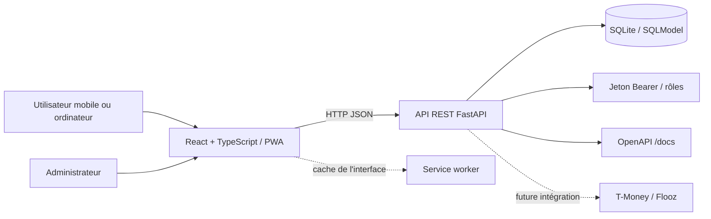
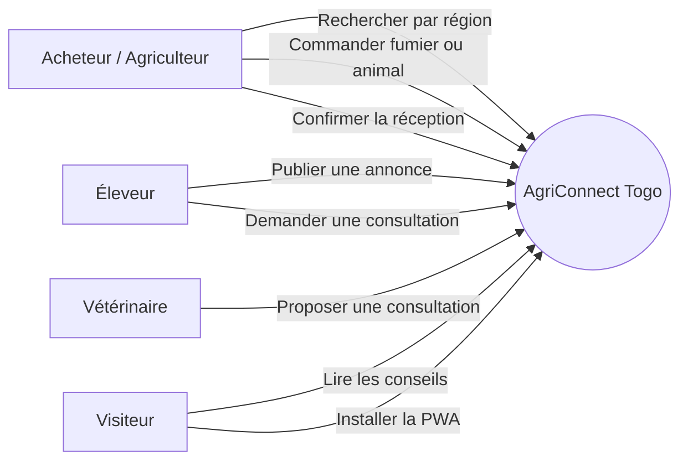
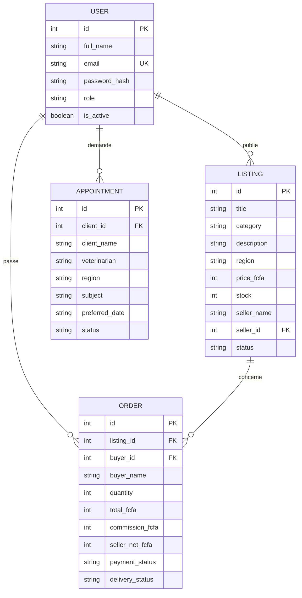
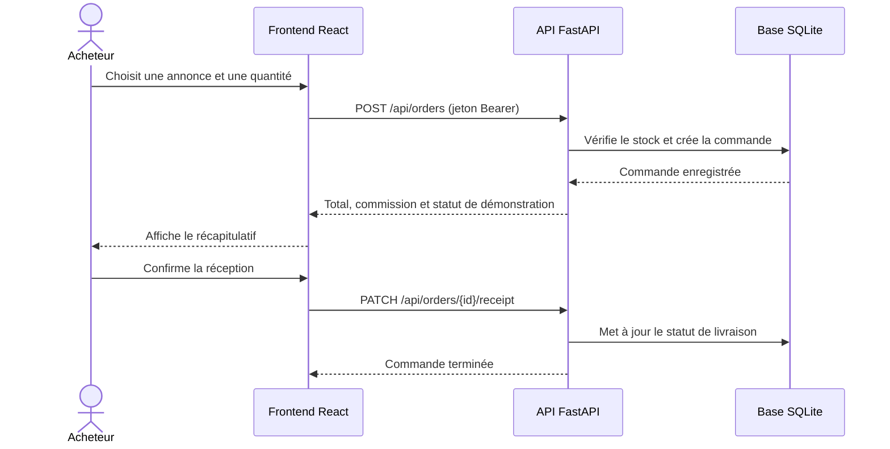

# Conception d'AgriConnect Togo

## 1. Contexte et objectif

AgriConnect Togo est une application web installable qui facilite les échanges
entre agriculteurs, éleveurs, vétérinaires et acheteurs. Le produit cible les
usages mobiles, les prix en FCFA, la recherche par région et les conditions de
connectivité limitée.

## 2. Périmètre du prototype

| Fonctionnalité | Acteur | Résultat |
|---|---|---|
| Créer un compte et se connecter | Acheteur, éleveur, vétérinaire | Session Bearer avec rôle |
| Parcourir, rechercher et filtrer les annonces | Acheteur | Trouver un animal ou du fumier par région |
| Passer une commande et suivre son état | Acheteur, vendeur | Commande enregistrée, commission calculée |
| Publier une annonce | Éleveur, agriculteur | Offre consultable dans le catalogue |
| Consulter les vétérinaires et demander un rendez-vous | Éleveur, vétérinaire | Demande enregistrée avec statut |
| Lire des conseils vétérinaires | Tous | Informations de prévention accessibles |
| Administrer les comptes et modérer les annonces | Administrateur | Suivi des utilisateurs, commandes et rendez-vous |
| Installer l'application et charger l'interface hors ligne | Tous | Coquille PWA mise en cache |

Le paiement est simulé : aucune transaction ni retenue d'argent réelle n'est
effectuée. Le prototype ne doit pas être utilisé pour traiter un paiement réel.

## 3. Exigences principales

### Exigences fonctionnelles

- Afficher les annonces avec catégorie, région, prix en FCFA et quantité.
- Filtrer les annonces par catégorie, région et texte.
- Créer une commande lorsque le stock est suffisant.
- Calculer une commission indicative à 5 % et conserver le montant net vendeur.
- Enregistrer une confirmation de réception pour terminer une commande.
- Enregistrer une demande de consultation vétérinaire.
- Permettre la publication d'une annonce avec validation des champs.
- Authentifier les comptes par mot de passe haché et jeton Bearer à durée limitée.
- Réserver les opérations d'administration au rôle `admin` côté API.
- Permettre à l'administrateur de consulter les indicateurs, commandes, annonces,
  comptes et rendez-vous, et de suspendre/réactiver les annonces ou comptes.

### Exigences non fonctionnelles

- Interface responsive pensée d'abord pour les petits écrans.
- API REST documentée automatiquement via OpenAPI.
- Stockage persistant SQLite pour le prototype.
- Ressources statiques essentielles mises en cache par le service worker.
- Montants exprimés en FCFA et dates affichées selon la locale française.

## 4. Architecture logique

## 5. Diagramme de cas d'utilisation

## 6. Modèle de données

## 7. Parcours de commande

## 8. Règles métiers

- Une commande ne peut pas excéder le stock disponible.
- `total = prix unitaire × quantité`.
- `commission = arrondi(total × 5 / 100)`.
- `net vendeur = total - commission`.
- Une nouvelle commande porte le statut `demo_pending` ; ce statut ne représente
  pas un paiement effectivement encaissé.
- La confirmation de réception modifie le statut de livraison et ne déclenche
  aucun transfert d'argent.
- Les dates de rendez-vous sont saisies au format ISO `YYYY-MM-DD`.

## 9. Routes principales

| Méthode | Route | Description |
|---|---|---|
| GET | `/api/health` | Vérifier l'état de l'API |
| POST | `/api/auth/register` | Créer un compte acheteur, éleveur ou vétérinaire |
| POST | `/api/auth/login` | Ouvrir une session |
| GET | `/api/auth/me` | Vérifier la session |
| GET | `/api/listings` | Lister et filtrer les annonces |
| POST | `/api/listings` | Publier une annonce (éleveur connecté) |
| GET | `/api/veterinarians` | Lister les vétérinaires de démonstration |
| POST | `/api/appointments` | Demander un rendez-vous |
| POST | `/api/orders` | Enregistrer une commande de démonstration |
| PATCH | `/api/orders/{id}/receipt` | Confirmer la réception |
| GET | `/api/admin/summary` | Indicateurs du tableau d'administration |
| GET | `/api/admin/users`, `/api/admin/orders` | Consulter les comptes et commandes (admin) |
| GET | `/api/admin/listings`, `/api/admin/appointments` | Consulter les annonces et rendez-vous (admin) |
| PATCH | `/api/admin/users/{id}/status` | Activer ou désactiver un compte (admin) |
| PATCH | `/api/admin/listings/{id}/status` | Suspendre ou réactiver une annonce (admin) |

## 10. Rôles et autorisations

L'API hache les mots de passe et signe des jetons Bearer limités à huit heures.
Les rôles sont `buyer`, `seller`, `vet` et `admin`. Les comptes peuvent être
créés uniquement avec les trois rôles publics ; l'administrateur est provisionné
par le jeu de données de démonstration. Les routes de modération font leur
contrôle de rôle côté serveur, indépendamment de l'interface.

## 11. Évolutions vers une version professionnelle

Supprimer les comptes et identifiants de démonstration, configurer un secret
durable, ajouter récupération de compte, validation des vétérinaires et des
vendeurs, téléversement sécurisé des photos, notifications SMS, intégration
contractualisée avec les opérateurs de paiement, journal d'audit, sauvegardes,
surveillance et conformité aux règles de protection des données applicables.
